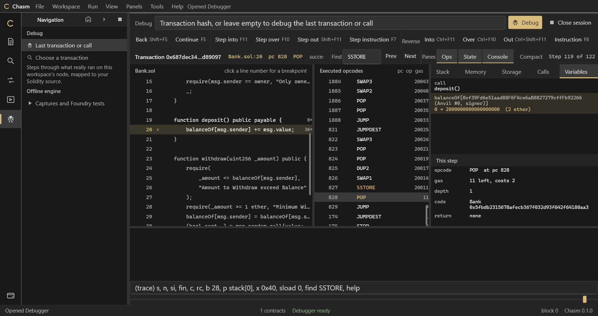
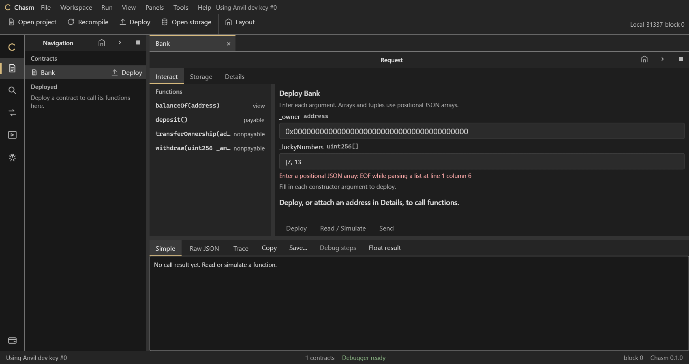
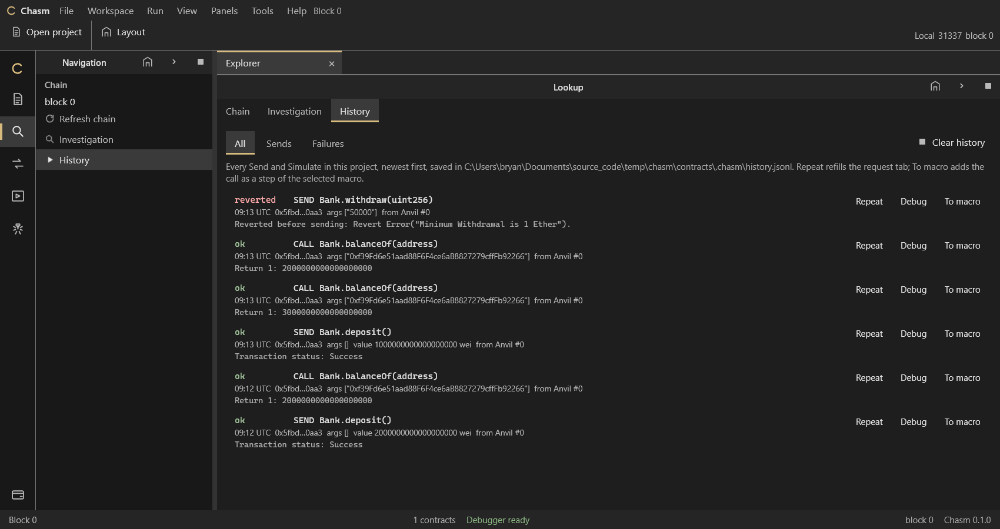
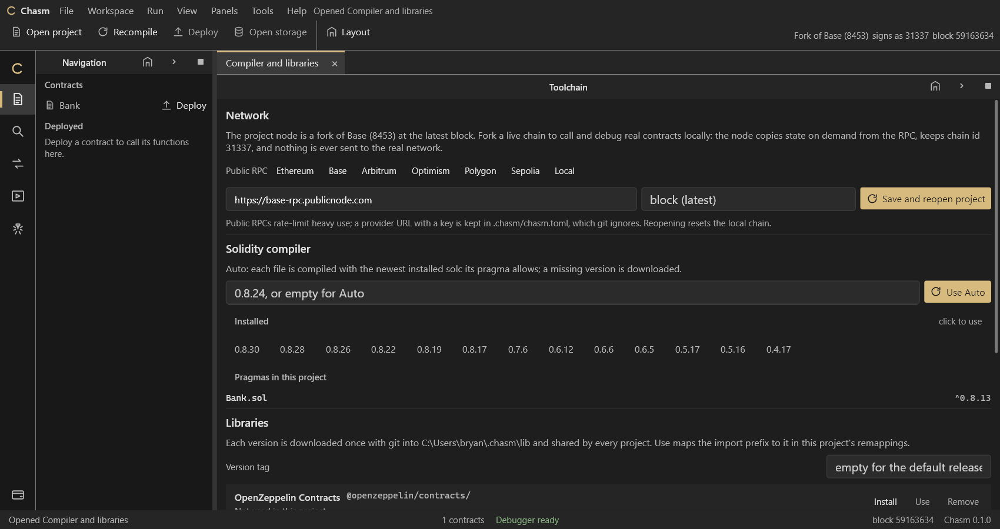

# Chasm

Chasm is a desktop workbench for Solidity development. Compile a project, deploy and call contracts on a local Anvil node, and inspect the recorded opcodes alongside source when a source map matches. Macros let you repeat local development checks.

> **Note:** Chasm is still a prototype. Feedback is welcome, and expect bugs.

## Screenshots











## Features

### Contracts
- **Templates.** *New contract from template* writes an ERC20, ERC721 or Ownable contract on OpenZeppelin v5 and recompiles; if OpenZeppelin is not mapped, the notice links to the library manager.
- **Foundry projects build as Foundry does.**
  - With `foundry.toml`, Chasm uses the project's own remappings and compiler settings, as `forge config` resolves them.
  - *Build source* in Compiler and libraries switches between Auto, Foundry and Chasm.
  - The two sources are never mixed.
  - Two copies of one library name both paths and the remapping that brought each.
- **Zero-config compile.** Chasm finds the Solidity files in the folder and compiles them with `foundry-compilers`; no `foundry.toml` is needed.
- **Deploy in place.** An undeployed tab shows its constructor form. Bind a deployment or attach an address before calling; entering an address alone does not bind the tab. Send and Simulate report why they cannot start, or start a job associated with that document so you can switch tabs.
- **Request editor.**
  - One field per ABI parameter.
  - Values in wei, gwei or ether, with an *ether to wei* helper for amount fields.
  - Simple, raw JSON and trace views of each result.
- **Readable reverts.** A Send that would revert is stopped before signing and shows the decoded reason (`Error`, `Panic` or a custom error). *Debug this call* opens the failing line.
- **Storage by name.**
  - Every state variable is read and decoded from the compiler's storage layout.
  - A mapping key reader and a raw slot reader sit below.
- **Known addresses are named everywhere.** Anvil accounts, your signer and each deployment show by name.

### Debugger
- **Step debugger** for transactions and calls the project node can trace:
  - step into, over and out, and single instructions, each with a reverse step;
  - breakpoints and opcode search;
  - Solidity locals where the build's AST and recorded stack allow reconstruction;
  - a gas profile per call and per source line.
- **Variables.**
  - The call's decoded arguments.
  - Every storage write by variable name, with its old and new value. Mapping keys and array indexes are recovered from the trace.
- **sevm-style console**:
  - `s`, `n`, `si`, `fin`, `c`, `rc`;
  - `b 28`, `p stack[0]`, `x 0x40`, `sload 0`, `find SSTORE`, `args`, `writes`, `locals`, `gas`;
  - `p balanceOf[0xf39F…]`, `p position.amount` at any step, and `diff` for the whole state change, without `cast index`;
  - `b op SSTORE if $1 > 100`, `watch balanceOf[0x…]`, several transactions in one session (`tx 2`), and `compare` against a saved trace.
- **Panes float and dock** like any other pane; *Panels > Trace debugger layout (sevm)* lays them out like the sevm TUI.
- **Offline engine captures** are saved in `.chasm/captures/` and replay without the network.
- **Saved traces** in `.chasm/traces/`. They reopen without the node.
- See [DEBUGGER.md](DEBUGGER.md).

### Chain
- **Timeline.**
  - Use *Snapshot now* before a change you may want to undo. Send, Deploy and chain edits also attempt to record checkpoints. Look for the checkpoint in Explorer > Timeline before relying on it.
  - Timeline keeps up to 200 points for this node session. A successful revert consumes the chosen snapshot and later ones. Reopening a project or restarting the node does not restore those checkpoints.
- **Cheats.** Advance time, set the timestamp, mine blocks, and set an address's balance, nonce, storage slot or code.
- **Explorer.**
  - The newest 100 blocks and transactions; search finds older ones.
  - Function selectors are named.
- **History.**
  - Every Send and Simulate is saved per project.
  - *Repeat* refills the request, *Debug* opens the trace, *To macro* adds it as a macro step.
- **Fork a live chain** at the latest or a chosen block: pick Ethereum, Base, Arbitrum, Optimism, Polygon or Sepolia, or paste any EVM RPC. Saved fork targets are **named network profiles** (Workspace > Network): switch between them with a preflight, and a target that never boots falls back to the network that ran before. A profile can keep its provider URL in an env var so keys stay out of `.chasm/chasm.toml`.
  - **Each network keeps its own state.** A switch or normal window close saves the node state, deployments, bound tabs and signer choice under `.chasm/networks/<id>/`. A forced exit does not save. On a fork with unknown identity, Chasm leaves the last checkpoint untouched; retry the chain lookup and reopen the project before resuming it. A confirmed *Clean fork* moves the old checkpoint aside rather than deleting it. Keystores must be unlocked again.
  - A profile can also run with the **source chain id** instead of 31337, so `block.chainid` and EIP-712 domains behave as on the real chain. In that mode Chasm refuses to send; reading, replaying and debugging work as usual.
  - Paste a real transaction hash to replay and step through it. Verified contracts show their source, fetched from Sourcify.
  - The workspace node executes with chain ID 31337, including `block.chainid` on forks. The source chain ID identifies the upstream network; the debugger uses it for unsigned replay on a separate node.
  - In Explorer, **Open verified contract** imports an address from Sourcify on the source chain. If Chasm recognizes a proxy at the local head, it uses the implementation's ABI but calls the entered address. Source and layout depend on what Sourcify supplies. The import records ABI provenance, not proof that the ABI matched local bytecode at a particular block.
  - Test RPC, Sourcify lookup and replay block lookup retry HTTP 429/503 with bounded backoff. This does not cover every RPC read or retry a transaction submission.
  - **Test RPC** checks the URL first (chain, head, fork block, archive state) and shows only its host.

### Project
- **Compiler.** Auto can use different solc versions for independent source groups; dependent imports still need compatible pragmas. Debugger build-info uses the resolved build settings and compiler lock. The offline worker accepts one compilation unit: if the workspace produces several solc versions, use a compatible lock or supply a single build-info file. Matching bytecode can yield source lines even when locals are unavailable.
- **Libraries.**
  - OpenZeppelin, OpenZeppelin Upgradeable, forge-std, Solmate and Solady.
  - Each is installed once into `~/.chasm/lib` and mapped per project.
  - Missing imports are flagged with the fix.
- **Macros.** A dry run reads current state and skips writes and their dependent steps. An ordinary run sends separate transactions; a later failure can leave earlier changes in place. Bundle mode queues consecutive sends and requests one mine per group before the next non-send step or the end. It does not guarantee inclusion order, a single block for the run, or atomic execution. On failure after setup, Chasm attempts to revert its snapshot and checks the head. Check the run status, receipts and node mining state if rollback or automining is uncertain. See [Reading a macro result](AI_CONTROL.md#reading-a-macro-result).
- **Ctrl+K** jumps to any deployed function, contract, transaction or view.

### AI control (opt-in)
A local API and MCP server let an AI client drive the app at a chosen tier.
No command ever returns a private key, mnemonic or password. See
[AI_CONTROL.md](AI_CONTROL.md). The [Chasm AI skill](.agents/skills/chasm-bugbounty/SKILL.md) explains how to interpret a command acknowledgment, trace or Macro result without assuming an operation succeeded.

## Installation

**Prerequisites:**
- [Foundry](https://getfoundry.sh) (`anvil`, `cast`, `forge`) in PATH.
- Git, to install Solidity libraries.

### Quick install

The installers download the last published pre-release. It predates the
native app on the `UI` branch; build from source to run it.

macOS (ARM64):
```bash
curl -fsSL https://raw.githubusercontent.com/ChasmHQ/chasm/main/install.sh | bash
```

Windows (PowerShell):
```powershell
iwr -useb https://raw.githubusercontent.com/ChasmHQ/chasm/main/install.ps1 | iex
```

Uninstall with `uninstall.sh` / `uninstall.ps1` from the same location.

### Build from source

```bash
git clone -b UI https://github.com/ChasmHQ/chasm
cd chasm
cargo build --release -j 6
./target/release/chasm ./contracts
```

On Windows, add the **absolute path** of this checkout's `target\release` folder to PATH once, then open a new terminal. If it is already on PATH, leave PATH unchanged. To update that installation, close the running app and run `cargo build --release -j 6` in the checkout. A plain `cargo build` updates `target\debug`, not the executable on PATH.

Verify in PowerShell before opening a project:

```powershell
(Get-Command chasm -CommandType Application).Source   # should end in target\release\chasm.exe
chasm --help                                        # Chasm desktop workbench for Solidity contracts
```

The desktop and the [offline engine](debugger/) live in this checkout. Native transaction tracing does not need Python. For **Captures and Foundry tests**, install [uv](https://docs.astral.sh/uv/) and run `uv sync --project debugger --locked` from the repository root. This builds the REVM extension and creates `debugger/.venv`; start Chasm as usual, with no second checkout or service to launch. The worker still runs in a separate local process.

To install the checkout build outside the repository, build `target/release/chasm` (or `chasm.exe`) first, then run **one** of these from the checkout root:

| Platform | Desktop with offline worker | Desktop only |
|---|---|---|
| Windows (PowerShell) | `.\install.ps1 -WithDebugger` | `.\install.ps1 -NativeOnly` |
| Linux / macOS | `bash install.sh --with-debugger` | `bash install.sh --native-only` |

Full installation builds a locked REVM wheel and installs it with the examples and a private Python environment, so the installed app does not need the checkout at runtime. It requires uv, Rust 1.91+ and a native build toolchain. Windows installs under `%LOCALAPPDATA%\Chasm` (`-NoPath` leaves PATH unchanged); Unix defaults to `~/.local` and accepts `--prefix /absolute/path`. Use `-DryRun` or `--dry-run` to preview. The no-argument download scripts above still fetch the older published release.

There is no Node.js step: the UI is compiled from `ui-slint/`. A debug build
of the large generated UI needs several GB of memory; see
[CLAUDE.md](CLAUDE.md#build-and-run).

## Usage

Run `chasm <folder>` on any folder with Solidity files, or start `chasm` and
choose a folder. The activity rail switches between Contracts, Explorer,
Converter, Macros and Debugger. Press **Ctrl+K** to find anything, and
**Help** for the keyboard shortcuts.

## Development

- [CLAUDE.md](CLAUDE.md): architecture, module map and the rules the code must keep.
- `cargo test`: unit and UI tests.
- `python tests/live/run.py`: end-to-end flows against a running build ([tests/live](tests/live/README.md)).
- [Workspace reliability plan](docs/WORKSPACE_RELIABILITY_PLAN.md): goals and acceptance checks for contract operations, verified imports, compiler consistency, fork RPCs and macros.
- [docs/archive/](docs/archive/): finished plans (NEXT_PLAN, REVERT_DEBUG_PLAN) and their progress; [CHANGELOG.md](CHANGELOG.md): what changed.
- [DEBUGGER.md](DEBUGGER.md): step debugger commands, keys and panes.

---
Built for the Ethereum development and security community.
