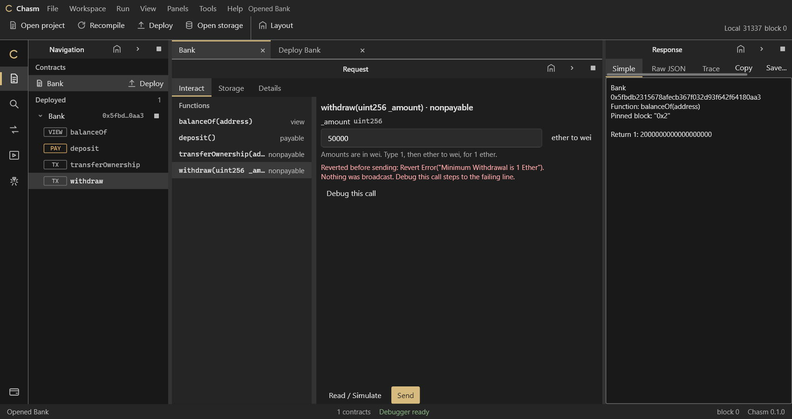
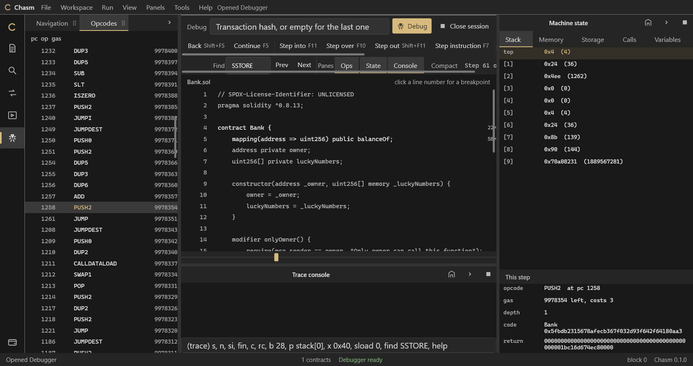
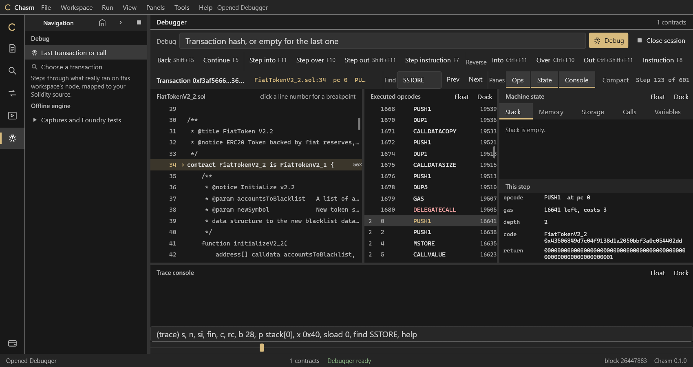
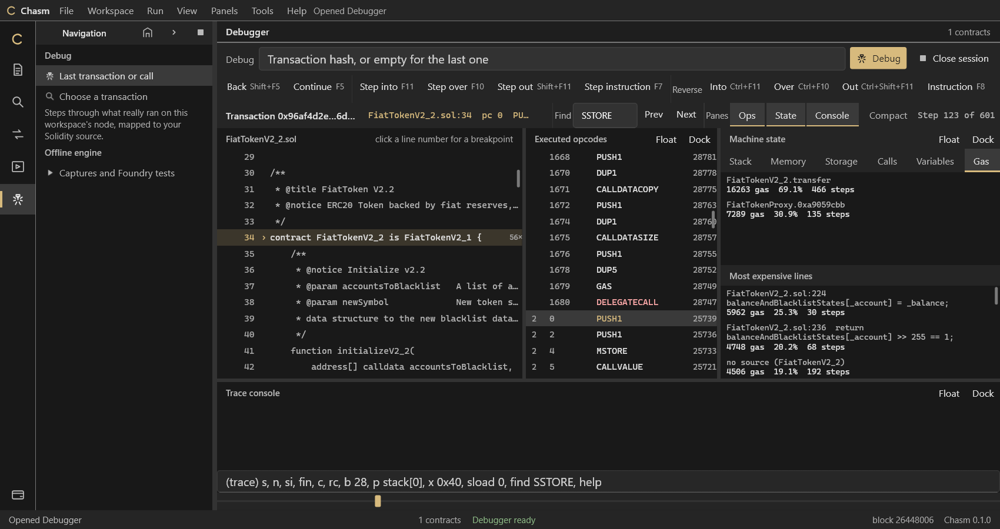
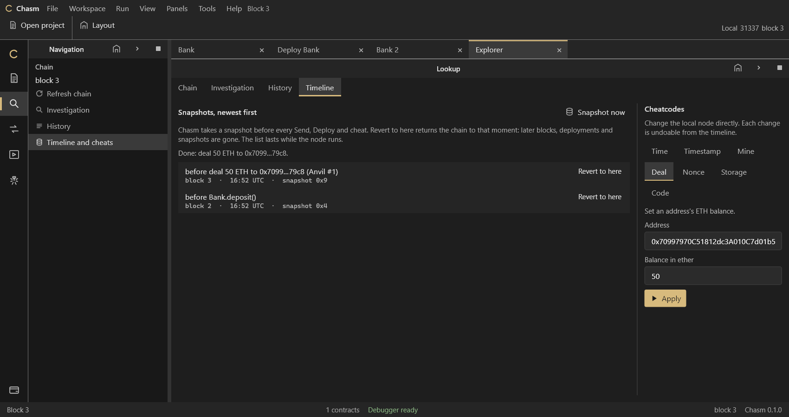
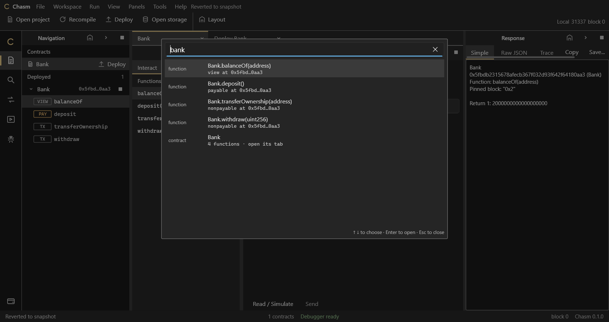

# Chasm

Chasm is a desktop workbench for smart contract development and security
work. It brings the Remix, Postman and Foundry workflows into one native app:
compile a Solidity folder, deploy and call contracts on a local node, step
through every opcode mapped to your source, script multi-step attacks as
macros, and fork a live chain to debug real transactions.

> **Note:** Chasm is still a prototype. Feedback is welcome, and expect bugs.

## Screenshots












## Features

### Contracts
- **Templates.** *New contract from template* writes an ERC20, ERC721 or Ownable contract on OpenZeppelin v5 and recompiles; if OpenZeppelin is not mapped, the notice links to the library manager.
- **Foundry projects build as Foundry does.**
  - With `foundry.toml`, Chasm uses the project's own remappings and compiler settings, as `forge config` resolves them.
  - *Build source* in Compiler and libraries switches between Auto, Foundry and Chasm.
  - The two sources are never mixed.
  - Two copies of one library name both paths and the remapping that brought each.
- **Zero-config compile.** Chasm finds the Solidity files in the folder and compiles them with `foundry-compilers`; no `foundry.toml` is needed.
- **Deploy in place.** An undeployed contract tab shows its constructor form above the functions, with Deploy beside Send. Deploy, call and debug take five clicks.
- **Request editor.**
  - One field per ABI parameter.
  - Values in wei, gwei or ether, with an *ether to wei* helper for amount fields.
  - Simple, raw JSON and trace views of each result.
- **Readable reverts.** A Send that would revert is stopped before signing and shows the decoded reason (`Error`, `Panic` or a custom error). *Debug this call* opens the failing line.
- **Storage by name.**
  - Every state variable is read and decoded from the compiler's storage layout.
  - A mapping key reader and a raw slot reader sit below.
- **Known addresses are named everywhere.** Anvil accounts, your signer and each deployment show by name.

### Debugger
- **Step debugger** for any transaction or call on the project node:
  - step into, over and out, and single instructions, each with a reverse step;
  - breakpoints and opcode search;
  - Solidity locals in scope at each step;
  - a gas profile per call and per source line.
- **Variables.**
  - The call's decoded arguments.
  - Every storage write by variable name, with its old and new value. Mapping keys and array indexes are recovered from the trace.
- **sevm-style console**:
  - `s`, `n`, `si`, `fin`, `c`, `rc`;
  - `b 28`, `p stack[0]`, `x 0x40`, `sload 0`, `find SSTORE`, `args`, `writes`, `locals`, `gas`;
  - `p balanceOf[0xf39F…]`, `p position.amount` at any step, and `diff` for the whole state change, without `cast index`.
- **Panes float and dock** like any other pane; *Panels > Trace debugger layout (sevm)* lays them out like the sevm TUI.
- **Offline engine captures** are saved in `.chasm/captures/` and replay without the network.
- **Saved traces** in `.chasm/traces/`. They reopen without the node.
- See [DEBUGGER.md](DEBUGGER.md).

### Chain
- **Timeline.**
  - A snapshot before every Send, Deploy and cheat.
  - *Revert to here* drops everything after that point.
- **Cheats.** Advance time, set the timestamp, mine blocks, and set an address's balance, nonce, storage slot or code.
- **Explorer.**
  - The newest 100 blocks and transactions; search finds older ones.
  - Function selectors are named.
- **History.**
  - Every Send and Simulate is saved per project.
  - *Repeat* refills the request, *Debug* opens the trace, *To macro* adds it as a macro step.
- **Fork a live chain** at the latest or a chosen block: pick Ethereum, Base, Arbitrum, Optimism, Polygon or Sepolia, or paste any EVM RPC. The status bar names the forked chain.
  - Paste a real transaction hash to replay and step through it. Verified contracts show their source, fetched from Sourcify.
  - The fork keeps chain id 31337, so nothing you sign is valid on the real network.
  - **Test RPC** checks the URL first (chain, head, fork block, archive state) and shows only its host.

### Project
- **Compiler.** Auto (per file pragma), or one solc version locked in `.chasm/chasm.toml`, downloaded when missing. Optimizer, runs, via-IR, EVM version and metadata hash are set there too. When they match how deployed code was built, the debugger shows its source. Immutables, linked libraries and code without a metadata hash still match.
- **Libraries.**
  - OpenZeppelin, OpenZeppelin Upgradeable, forge-std, Solmate and Solady.
  - Each is installed once into `~/.chasm/lib` and mapped per project.
  - Missing imports are flagged with the fix.
- **Macros.** Build multi-step scripts in a form (call, raw send, storage read, snapshot, revert, assert) or as JSON, and run them against the local node.
- **Ctrl+K** jumps to any deployed function, contract, transaction or view.

### AI control (opt-in)
A local API and MCP server let an AI client drive the app at a chosen tier.
No command ever returns a private key, mnemonic or password. See
[AI_CONTROL.md](AI_CONTROL.md).

## Installation

**Prerequisites:**
- [Foundry](https://getfoundry.sh) (`anvil`, `cast`, `forge`) in PATH.
- Git, to install Solidity libraries.

### Quick install

The installers download the last published pre-release. It predates the
native app on the `native-ui` branch; build from source to run it.

macOS (ARM64):
```bash
curl -fsSL https://raw.githubusercontent.com/ChasmHQ/chasm/main/install.sh | bash
```

Windows (PowerShell):
```powershell
iwr -useb https://raw.githubusercontent.com/ChasmHQ/chasm/main/install.ps1 | iex
```

Uninstall with `uninstall.sh` / `uninstall.ps1` from the same location.

### Build from source

```bash
git clone -b native-ui https://github.com/ChasmHQ/chasm
cd chasm
cargo build --release -j 6
./target/release/chasm ./contracts
```

On Windows, add the **absolute path** of this checkout's `target\release` folder to PATH once, then open a new terminal. If it is already on PATH, leave PATH unchanged. To update that installation, close the running app and run `cargo build --release -j 6` in the checkout. A plain `cargo build` updates `target\debug`, not the executable on PATH.

Verify in PowerShell before opening a project:

```powershell
(Get-Command chasm -CommandType Application).Source   # should end in target\release\chasm.exe
chasm --help                                        # Chasm desktop workbench for Solidity contracts
```

There is no Node.js step: the UI is compiled from `ui-slint/`. A debug build
of the large generated UI needs several GB of memory; see
[CLAUDE.md](CLAUDE.md#build-and-run).

## Usage

Run `chasm <folder>` on any folder with Solidity files, or start `chasm` and
choose a folder. The activity rail switches between Contracts, Explorer,
Converter, Macros and Debugger. Press **Ctrl+K** to find anything, and
**Help** for the keyboard shortcuts.

## Development

- [CLAUDE.md](CLAUDE.md): architecture, module map and the rules the code must keep.
- `cargo test`: unit and UI tests.
- `python tests/live/run.py`: end-to-end flows against a running build ([tests/live](tests/live/README.md)).
- [NEXT_PLAN.md](NEXT_PLAN.md): the last plan and its progress (all done); [CHANGELOG.md](CHANGELOG.md): what changed.
- [DEBUGGER.md](DEBUGGER.md): step debugger commands, keys and panes.

---
Built for the Ethereum development and security community.
